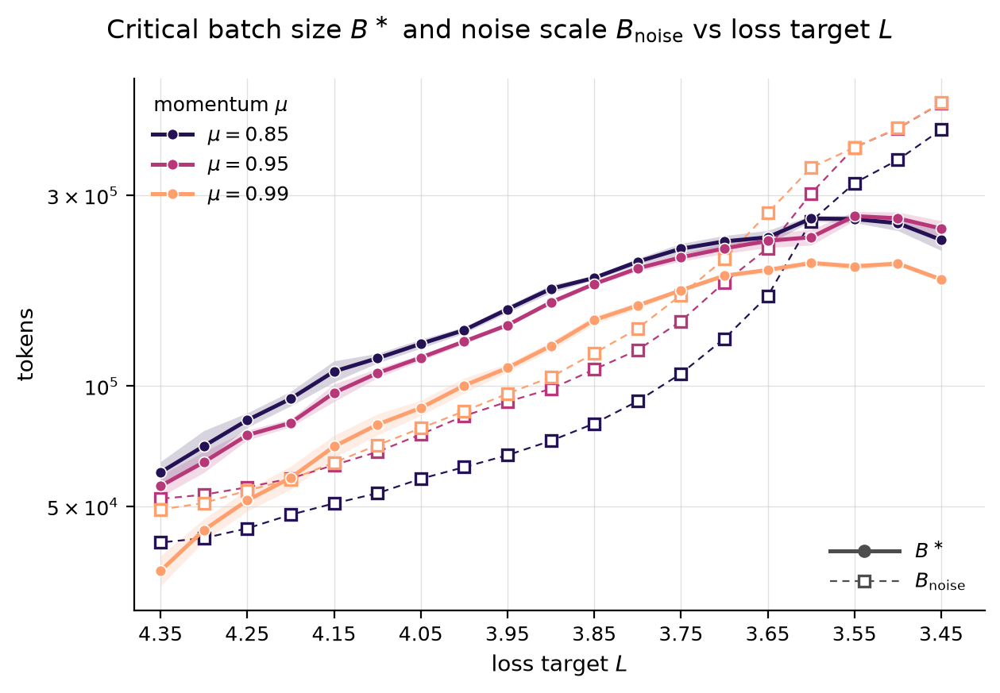

# Muon's critical batch size

Does the Muon optimiser have a critical batch size, does momentum move it, and does McCandlish's gradient noise scale still predict it under Muon's non-linear Newton–Schulz update? In this analysis we answer all 3 questions. Measured over 124 training runs of a 162M GPT-2 on FineWeb10B.

Report: [chutommy.com/projects/muon-critical-batch](https://chutommy.com/projects/muon-critical-batch/)



Based on [modded-nanogpt](https://github.com/KellerJordan/modded-nanogpt) by Keller Jordan.

```
requirements.txt          figure dependencies
requirements-train.txt    full training environment (Linux, CUDA)
run.py                    reproduces figures (default) or full pipeline (--full)
run.sbatch                runs slurm job (single config or array)
src/
    train.py              trains modded-nanogpt (track 3)
configs/
    generate_sweep.py     spits out 124-config sweep
    sweep/                per-run JSON config (generated)
data/
    cached_fineweb10B.py  fineweb downloader
results/                  per-run JSON result
logs/                     per-run TEXT log and SLURM stdout
analysis/
    parse.py              turns results JSON into analysis PARQUET
    tables/               analysis PARQUET (generated)
    plots/                per-figure plot script
    figures/              per-figure PDF and PNG
```

## Reproduce figures

All logs and per-run results are shipped in this repo, so the figures are ez to re-generate:

```
pip install -r requirements.txt
python run.py
```

This builds `analysis/tables/*.parquet` from `results/*.json` and writes figures to `analysis/figures`.

## Reproduce results

Single-node setup, on every local GPU:

```
pip install -r requirements-train.txt
python run.py --full
```

This downloads data, generates 124 sweep configs, trains them all, then parses and plots.

Alternatively, run on a SLURM cluster:

```bash
python data/cached_fineweb10B.py 40
python configs/generate_sweep.py
sbatch --array=0-123%4 run.sbatch
python run.py
```

This downloads data, generates 124 sweep configs, trains them all, then parses and plots :)
